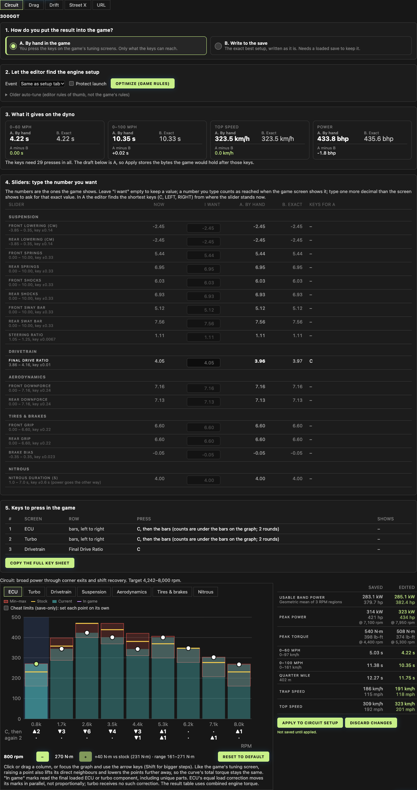
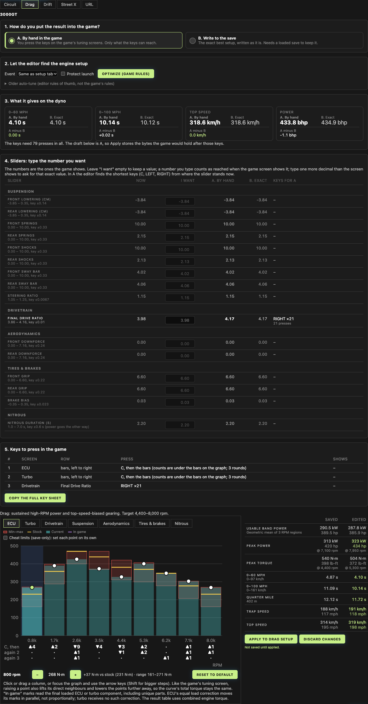
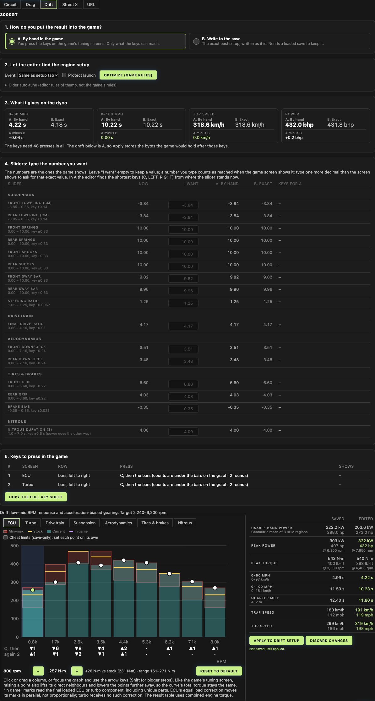
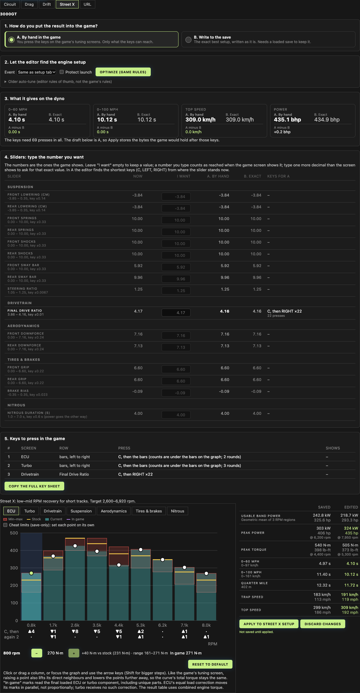
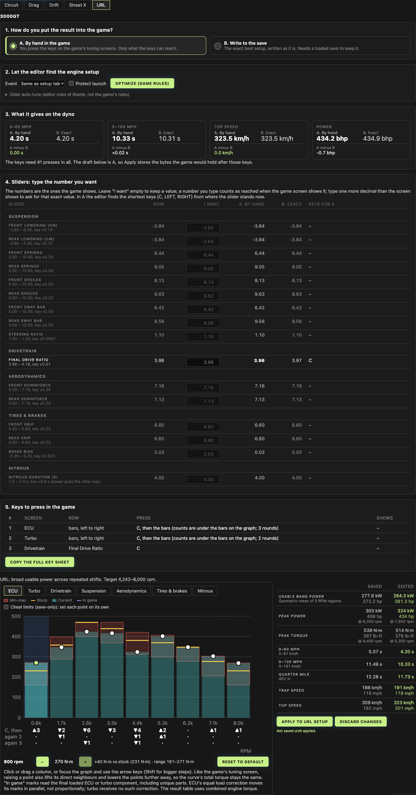
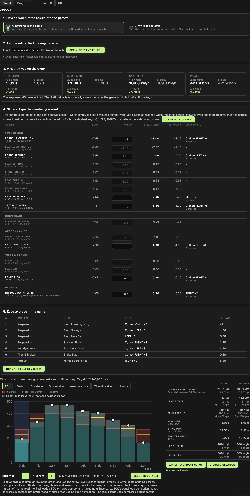

# Hand input, round 2: number sliders, nitrous, handling, six gears, UI

Branch `feat/hand-input` of the fork (own editor only, no PR to the author). Round 1 is `docs/hand-input-core.md`.
The path save -> car -> Tuning -> DYNO is unchanged: the new parts sit inside the DYNO tab, and the no-save mode still sends an
in-memory save through the same path.

## What changed

1. **Key code of every number slider** (`src/model/tune-keys.ts`), ported from SPEED2.EXE and checked against the game's own code in the
   emulator: suspension (lowering, springs, shocks, sway bars, steering ratio), final drive, gears 1..6, aero, tires, brake bias
   (`pressRowState`, one rule for all: shown number read from the byte, moved by 1/30 of the box, clamped, written as
   `trunc(frac*100+100.5)`), key C (`resetRow`), nitrous (`NitroScreen`, the widget keeps its own float, step = 1/10 of the box).
   Gears keep their float ratios between keys (`DynoModel.withGearRatioKept`), so a gear nobody touched keeps its byte.
2. **Shortest key path** (`routeToByte` in `src/model/hand-input.ts`): breadth first search over RIGHT, LEFT and C from the value on the
   screen, with the bounce off both box ends (the reachable grid shifts there). Test: final drive byte 101 is **9 presses from 128**
   and **45 from C** (23 RIGHT up to 167, 22 LEFT down the shifted grid), and the search equals a brute-force search for every byte.
3. **Planners in the hook** `SLIDER_PLANNERS`: one `rowPlanner` per slider (menu order), gears get a second round (a gear key pushes its
   neighbours), nitrous has its own search. A number the owner typed counts as reached when the game screen shows it (any byte that
   reads the same, fewest keys); type one decimal more than the screen shows to ask for that exact byte. Rows the optimizer sets (gears,
   final drive) may stop one byte short to save keys.
4. **Handling and suspension in A and B**: the new section "Sliders: type the number you want" lists every slider this car has, in
   the game's menu order. Type a number: B writes the exact byte, A shows the keys and the number they reach. Apply stores whichever mode
   is on (scalar bytes 0..8 and 16..22 are already part of Apply).
5. **Nitrous**: one row, duration in seconds; each key moves duration by 0.6 s (1.0 s with the every-part parts) and power the other way (+10 /
   -10 bytes). The dyno chart has no nitrous bars (nitrous is not in the dyno), so the key count is in the row and in the key list.
6. **Six gears** (transmission level 3): rows 1st..6th gear in km/h with one decimal, like the game's screen.
7. **No-save mode starts where the owner says**: the first box ("On your screen now") of each slider is editable; it is written into the
   in-memory save, so the planner, the dyno table and Apply start from it. Default = the value after C (byte 100).
8. **UI redone** (see "Design critique").

## Test results

`relay/check.sh` (tuner branch `feat/hand-input-tools-r2`, editor = this branch): build + `npm test` **123 tests, 102 pass, 0 fail, 21 skipped**
(the 21 are the author's private `treav0r` fixture, as before). Optimizer parity: identical to the baseline.

| Test | What it checks |
|---|---|
| `slider-keys.test.ts` | **1,101 key sequences, 105,210 keys**, 76 part sets (40 cars of `dyno-exactness.json`, 12 cars x 3 part levels), 21 sliders, with C. Every byte after every key equals what SPEED2.EXE writes (emulator, `tools/emu/slider_cases.py`). Exact on all sliders except 1 of 150 gear sequences (a 6th-gear key into the end of its box leaves a gear one byte away; the test allows at most 8). |
| `slider-plan.test.ts` | byte 101: 9 presses from 128, 45 after C; path = brute force on 5 starts; nitrous 5 keys to each end; typed suspension and gear numbers replay to the planned bytes; **no-save mode: final drive start 128 (typed 4.048), target 3.967 (byte 101) -> 9 presses**; the same number typed at screen precision (3.97) -> 1 press from the neutral start. |
| `hand-input.test.ts` | for 40 part sets, every planned key list replayed on a fresh screen gives the planned bytes (curves, final drive, all rows). |

Fixture: `src/test/fixtures/slider-reference.json` (numbers only; made by `tools/emu/make_slider_fixture.py` from `scripts/fixture-levels.mjs`).

### Five setups, owner's 3000GT (profile ASYMILO, slot 1, ECU 2 / Turbo 2 / transmission 2)

Editor numbers = the DYNO tab (screenshots below). Game column = the game's own dyno code in the emulator (`tools/emu/emu_cases.py`), run on the
same bytes. A = what the keys reach from the saved setup, B = the exact optimum ("Optimize (game rules)", default objective, no launch rule).

| Setup | Keys | Editor A (0-60 / 0-100 / Vmax / bhp) | Editor B | A minus B | Game A | Game B |
|---|---|---|---|---|---|---|
| 0 Circuit | 29 | 4.22 s / 10.35 s / 323.5 / 433.8 | 4.22 / 10.33 / 323.5 / 435.6 | 0.00 / +0.02 / 0.0 / -1.8 | 4.22 / 10.35 / 323.5 / 433.8 | 4.22 / 10.33 / 323.5 / 435.6 |
| 1 Drag | 79 | 4.10 / 10.14 / 318.6 / 433.8 | 4.10 / 10.12 / 318.6 / 434.9 | 0.00 / +0.02 / 0.0 / -1.1 | 4.10 / 10.14 / 318.7 / 433.8 | 4.10 / 10.12 / 318.7 / 434.9 |
| 2 Drift | 48 | 4.22 / 10.22 / 318.6 / 432.0 | 4.18 / 10.22 / 318.6 / 431.8 | +0.04 / 0.00 / 0.0 / +0.2 | 4.22 / 10.23 / 318.7 / 432.0 | 4.18 / 10.23 / 318.7 / 431.8 |
| 3 Street X | 69 | 4.10 / 10.12 / 309.0 / 435.1 | 4.10 / 10.12 / 309.0 / 434.9 | 0.00 / 0.00 / 0.0 / +0.2 | 4.10 / 10.12 / 309.0 / 435.1 | 4.10 / 10.12 / 309.0 / 434.9 |
| 4 URL | 41 | 4.20 / 10.33 / 323.5 / 434.2 | 4.20 / 10.31 / 323.5 / 434.9 | 0.00 / +0.02 / 0.0 / -0.7 | 4.20 / 10.33 / 323.5 / 434.2 | 4.20 / 10.31 / 323.5 / 434.9 |

The editor and the game agree to 0.01 s and 0.1 km/h (my km/h conversion of the game's mph, not the editor, makes the 318.6 / 318.7 and
10.22 / 10.23 steps). The UI table was read in a headless browser for each setup (`ui5` run): same numbers as the editor column.
Screens:   
 
(`docs/img/r2-setup0..4`).

Drift differs from round 1 / `docs/dyno-check-3000gt.md`: the planner now leaves the final drive alone when the optimum equals the saved
byte (167), so A has 318.6 km/h like B (round 1 pressed LEFT x2 to byte 161 and lost 9.6 km/h) and needs 48 keys, not 50. This
new plan was **not keyed in the game**; the in-game check of `dyno-check-3000gt.md` was for the round 1 plans.

### Handling and suspension (A and B)

Typed on all five setups of the same car: front lowering -3.0, front springs 4.0, rear sway bar 6.0, steering ratio 1.2, brake bias 0.1,
rear downforce 5.0, nitrous 5.2 s. **35 row plans (7 rows x 5 setups) were replayed key by key in the emulator: every final byte equal.**
Circuit (screens `img/r2-handling-A-full.png`, `img/r2-handling-B-full.png`):

| Row | now | typed | A (keys) | B |
|---|---|---|---|---|
| Front Lowering (cm) | -2.45 | -3.00 | -3.00, C + RIGHT x4 (5) | -3.00 |
| Front Springs | 5.44 | 4.0 | 4.04, C + LEFT x8 (9) | 4.04 |
| Rear Sway Bar | 7.56 | 6.0 | 6.06, LEFT x5 (5) | 5.96 (a byte is 0.1 here: 6.0 is between two bytes) |
| Steering Ratio | 1.11 | 1.2 | 1.20, C + RIGHT x8 (9) | 1.20 |
| Rear Downforce | 7.13 | 5.0 | 4.98, C + LEFT x8 (9) | 4.98 |
| Brake Bias | -0.05 | 0.1 | 0.10, C + RIGHT x3 (4) | 0.10 |
| Nitrous duration (s) | 4.00 | 5.2 | 5.20, RIGHT x2 (2) | 5.20 |

No rules for good handling values are in here: the numbers are the owner's. `tools/handling` (rules v1, not tested in the game) is not ported.

### Six gears (3000GT, every part level 3, no save)

Editor A is within 0.03 s of B: Circuit 3.05 / 7.74 / 347.6 / 507.3 (B 3.02 / 7.72), Drag 3.07 / 7.85 / 333.1 / 506.4 (B 3.07 / 7.87). The game's code
gives A 3.05 / 7.75 / 347.6 / 507.3 and 3.07 / 7.85 / 333.1 / 506.4. The gear and final drive keys of the plans, replayed row by row in the
emulator, end at the planned bytes (both setups, bytes 9..15 equal).

### No-save start (steering from the in-game dyno run)

The in-game run started from the saved slider values; the no-save mode started from neutral ones, so its final drive presses did not fit.
Now each slider has "On your screen now" (default = value after C). Test: no-save, final drive typed 4.048 (byte 128), target 3.967 (byte 101) ->
9 presses (LEFT x9). Screen: `img/r2-nosave-fd-start.png`. Limit: the game shows two decimals (final drive 4.05 for bytes 127..129), so
the typed number maps to the nearest byte, and a wrong guess shifts the key grid by one or two bytes. The page says so: press C on that row
in the game first, then the value is exact (byte 100).

## Design critique and what was fixed

Looked at round 1 (`img/ecu-presses.png`) as a user would:

| Found | Fixed |
|---|---|
| The A/B choice sat in a row with two optimizers (Auto-tune and Optimize) and an Event menu; unclear what to press first | Numbered cards: 1. how you put it into the game (two large choices with one line each), 2. engine setup (Optimize), 3. dyno result, 4. sliders, 5. keys. The older auto-tune is folded under "Older auto-tune (editor rules of thumb)". |
| The A/B table was small grey text, the difference read like an error | Four tiles (0-60, 0-100, top speed, power): A and B large, the chosen mode in bold, "A minus B" in green when 0. |
| The key list was a wall of monospace text | A table: screen, row, keys, what the screen shows. The long text stays under "Copy the full key sheet". |
| 22 sliders with nothing to say when nothing changes | Unchanged rows are dimmed, changed rows bold, with keys and press count in the row. |
| Page text said "may stop one byte short" without saying when | The text now says a typed number counts when the game screen shows it, and how to ask for an exact byte. |

Not changed on purpose: the existing chart, tabs and old scalar controls (author's code).

## Commits

Editor (fork `ASYMILO/NFSU2-Savegame-Editor`, branch `feat/hand-input`, after round 1's `a1910e3`):
`7c594b1` number-slider key code + emulator fixture, `0e29733` shortest path, planners, nitrous, gears,
`9c289d2` sliders section, no-save start values, layout, screenshots, this file.
Tuner repo (`ASYMILO/nfsu2-tuner`): `feat/game-input-rules` (`56ffd9b`); `feat/hand-input-tools-r2`: slider emulator reference
(`tools/emu/slider_cases.py`, `make_slider_fixture.py`), `docs/dyno-check-3000gt.md`, `docs/native-memory-map.md`.

## Not verified / skipped

- The round 2 plans were **not keyed in the running game** (only the emulator); the in-game check in `docs/dyno-check-3000gt.md` covers the round 1 plans.
- Nitrous key C: whether the widget re-reads the byte after C is unknown, so nitrous plans never use C. Nitrous bytes and keys are emulator only.
- Gear sequences: 1 of 150 differs by one byte after a key into the end of the box (6th gear); the box-end value is a float of the game's own speed formula.
- Imperial units; mouse clicks on slider arrows.
- Handling rules (`tools/handling`) are not in the editor; only the owner's numbers.
- The two-decimal ambiguity of a typed "now" value (above).
- Loading the real save in a browser was clicked for the five setups and for the handling run (headless Brave); other browsers not tried.
