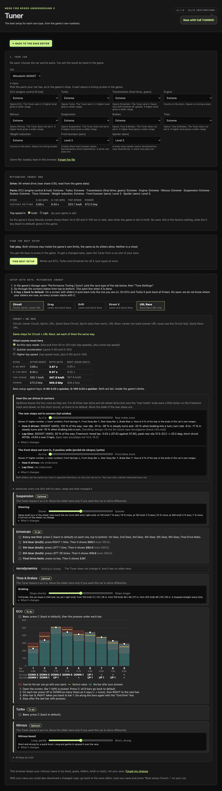
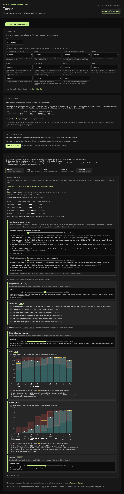
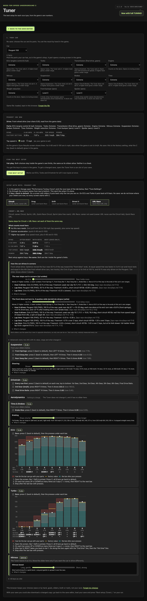
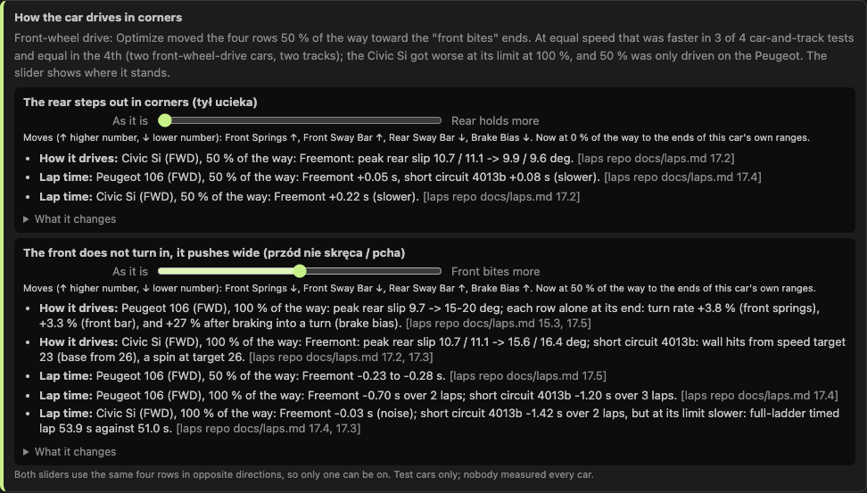
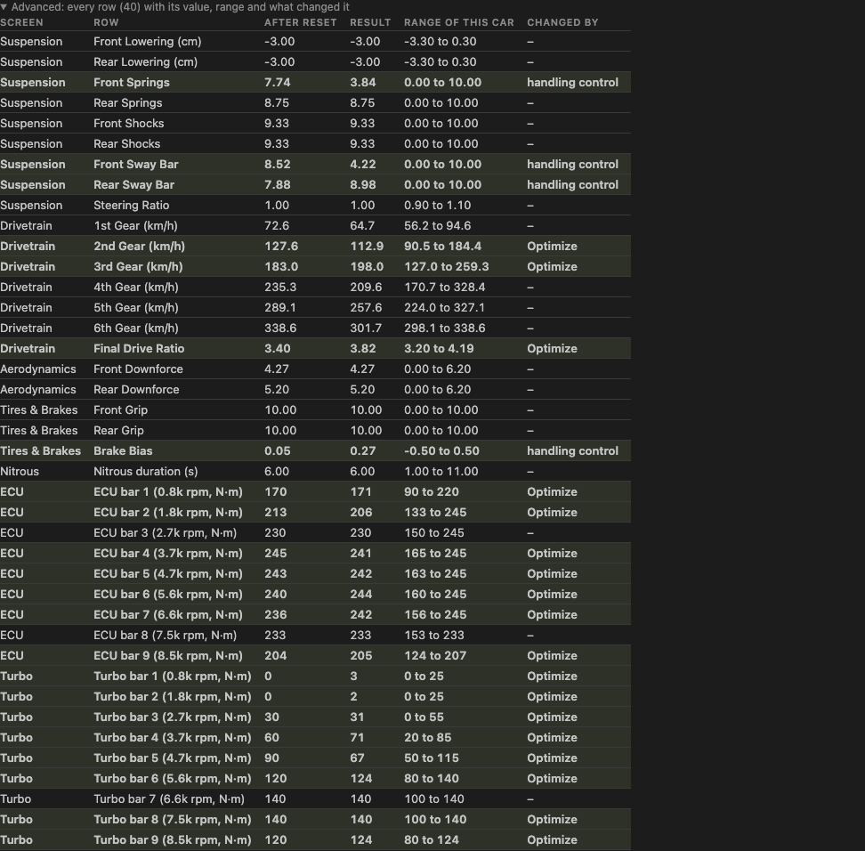

# Handoff 3o (2026-11-09/10)

Branch `feat/tuner-3o` (from `feat/tuner-circuit-roll` b0a1fa3, which has the r3m design). Fork only: `git push fork feat/tuner-3o`. No PR. `origin` is hackch: never pushed. `dev` / `main` not touched.
Owner, verbatim: "pamiętaj że my nie tunujemy mojego samochodu tylko tworzymy tuner dla całej społeczności graczy"; "nie chodzi o 'najlepiej wyglądające wyniki' tylko o faktyczną jazdę w grze"; "moje auto w trakcie wyścigu ucieka tyłem".
All cars below are test cars. Nothing here is tuned for one player's car.

## Built
New file `src/model/handling.ts` (all logic), wired into `src/controller/tuner-controller.ts`, `editor-scope.ts`, `index.html`, `app.css`. `feel.ts`: only `toward` is now exported.

1. **Drivetrain from the game data.** `driveShare(model)` = `p[0x1C0]`, `drivetrainOf`: below 0.2 FWD, above 0.8 RWD, between AWD (float32 compare; the game's split, `FUN_005a7530`, laps repo Step 14.2). Shown on the car card as "Drive: Rear-wheel drive (rear share 1.00, read from the game data)". Checked on the game file: 3000GT 0.5, RX-8 1.0, Peugeot 106 0.0, Civic 0.0, 350Z 1.0.
2. **Handling rows in Optimize, by drivetrain.** Rows: front springs (0), front sway bar (2), rear sway bar (6), brake bias (18).
   - RWD / AWD: no default. The rows stay as Optimize leaves them (the saved value).
   - FWD: a default toward the anti-push ends (soft front springs, soft front bar, stiff rear bar, brake to the rear), **`ANTI_PUSH_DOSE = 0.5`** in `handling.ts`: the only place the dose is written. The v11 round changes that one number. It applies on the lap tabs only (`DOSE_TABS = [0, 4]`: Circuit and URL); Drag, Drift and Street X get none because nobody drove them.
   - The ends are each car's own box: the shown range of the row for its parts (`rowScale`), moved with `setRowShown`. Checked: 3000GT / RX-8 / Peugeot 106 end bytes differ per car; stable ends are the high byte for rows 0 and 2 and the low byte for 6 and 18 on all three.
   - The dose is a share of the distance from the row's value (after Optimize and the Braking slider) to the box end, so a saved value that is not the factory one is respected.
3. **Two symptom sliders** per card, 0..100 in steps of 25, both moving the same four rows in opposite directions (so the one that moves switches the other off):
   - "The rear steps out in corners (tył ucieka)": toward the stable ends (stiff front springs and bar, soft rear bar, brake to the front).
   - "The front does not turn in, it pushes wide (przód nie skręca / pcha)": toward the anti-push ends. On a FWD car on Circuit / URL this one starts at 50 (the default), so the default is visible and can be taken off.
   - Under each slider: the measured lines for **this car's drivetrain**, a "How it drives" kind and a "Lap time" kind, each with its dose, numbers and source (laps repo `docs/laps.md` step, or `handling-design-r3l.md` 3m). Where no test of that drivetrain and kind exists the line says **"nie zmierzone"**. All numbers are in `FINDINGS` in `handling.ts`, copied from the docs; nothing computed or guessed.
   - Slider positions are **not kept** between cars (`browser-store` keys unchanged): a position tied to the drivetrain must not move to another car.
   - A side closes when no row has room that way; no suspension or brake parts: no sliders.
4. **Advanced panel** (folded, per card): every row of the car's tuning screens (40 rows on the Peugeot: 9 suspension, 7 drivetrain, 2 aero, 3 tires and brakes, nitrous, 9 ECU and 9 Turbo bars) with value in the save (or after reset), value in the result, the range of this car's parts, and "changed by": Optimize / driving slider / handling control.
5. **Tests**: `src/test/handling.test.ts`, 9 tests (split at 0.2 / 0.8; drivetrain read for 8 cars; default dose only on FWD lap tabs and from the constant; slider record rules; end directions and per-car boxes; dose halfway; sliders open / closed; every finding has a source and "nie zmierzone" where nothing was measured; advanced rows and "keys reach the target within a byte").
   `NFSU2_GLOBALB=<laps repo>/data/game/GLOBALB.BUN npm test`: **163 tests, 163 pass, 0 fail, 0 skipped** (154 before + 9). `save.test.ts` not touched (70 tests, same).
6. **Screenshots** (`docs/img/`, headless Brave, no-save path, all parts at the top level so every screen is open; the save path was also clicked once with the author's `testfile/treav0r`, RX-8 car, no page errors, slider switch-off checked):
   - 3000GT AWD: 
   - RX-8 RWD: 
   - Peugeot 106 FWD (default 50 % on the front-bites slider): , the handling block  and the advanced panel 

## What the numbers say (so nobody over-reads the cards)
- Measured on 5 test cars, 2 tracks, doses 50 % and 100 % only. No middle positions, no Drag / Drift / Street X, lap time only from the laps harness (no human driving).
- RWD / AWD (3000GT, RX-8, 350Z): the stable ends were a little faster on Freemont and slower on the short circuit (+0.25 to +0.50 s). So no default, only a slider. Rear slip falls (3000GT bench -31..-36 % in steady turns, 350Z -4 deg) at a cost in turn rate (-6..-11 %).
- FWD: anti-push faster at equal speed in 3 of 4 car and track cases (-0.70, -1.20, -1.42 s), equal in the 4th; the Civic Si gets worse at its limit at 100 %; 50 % was driven on the Peugeot only. That is why the default is 50 % and why v11 decides 50 vs 100.
- The sway bars' effect rests on the game measurements alone: the game's anti-roll function was not found (`docs/setup-bytes.md` in the laps repo, "Anti-roll bar"). The card says so.

## Open
1. v11: 50 % or 100 % for FWD (change `ANTI_PUSH_DOSE`; the finding lines may need the new numbers). The Civic Si at 50 % and the Civic bench of its ends are not measured.
2. Drag, Drift and Street X handling: not driven. Optimize gives no default there; sliders still work (the lines say what exists).
3. Slider middle positions (25 / 50 / 75) are not measured on the bench; the cards quote only the doses that were driven.
4. End bytes: the editor encodes a box end by rounding (as the game's setter), the laps tool by the first saturated byte; with the same parts they differ by at most one byte and give the same clamped value. Part sets also differ (the laps cars carry the 3000GT's 34 flags), so the byte numbers in the laps docs (e.g. Peugeot rear bar 117) are not equal to the editor's for "all parts level 3" (121).
5. Zone 12 on 4013b (wall corner) decides the RWD / AWD result in the laps docs (item 2 of "Open after v10"): if widened and re-run, the RWD / AWD finding lines and the note may change.
6. Not run: a human drive of the FWD default, other browsers than Brave, narrow screens.
7. Wording: the page is English; the two slider names carry the owner's Polish in brackets and "nie zmierzone" is Polish on purpose (the brief's words).
