# Tuner, round 3: one simple screen

Branch `feat/tuner-r3` of the fork (off `feat/hand-input` 03c85ef). Own editor only, no PR to the author.
Rounds 1 and 2: `docs/hand-input-core.md`, `docs/hand-input-round2.md`.

Owner's feedback (2026-11-06): no race type choice, say how URL works, merge what is the same, "Protect launch" unclear,
too much information. Wanted flow: load a save or pick the car and parts, press Optimize, get what to set for every race type,
optional preferences.

## 1. Where the screen sits (variants)

| | Variant | Verdict |
|---|---|---|
| 1 | `tuner.html` with its own controller | Rejected. "Write to save" needs the save: load, nfsu2-web ZIP profiles, checksums, download. All of it lives in the closure of `EditorController` (`src/controller/editor-controller.ts` l.60-70: `data`, `backup`, `game`) and would be copied. |
| 2 | Move the editor's state into an Angular service, two controllers | Rejected. Refactors the author's whole controller (1,349 lines) for one screen. |
| 3 | **A first view in `index.html`, logic in its own file** | **Chosen.** `index.html`: a nav "Tuner / Save editor" and a `<main ng-show="view === 'tuner'">` before the author's `<main>`, which only gets `ng-show="view === 'editor'"`. Logic: `src/controller/tuner-controller.ts` (`attachTuner`) and `src/model/tuner.ts`. The author's controller gets 17 lines: keep the game file bytes, call `tunerSync()` in `refresh`, `rejectFile` and `applyGameData`, and hand the tuner four functions (`save`, `game`, `gameBytes`, `apply`). |

The author's path save -> Car slots -> Tuning… -> tabs is unchanged and one click away ("Save editor"). Checked in the browser:
the save loads there, slot 2 opens Tuning, DYNO shows the 3000GT (`img/r3-6-save-editor.png`, `img/r3-7-author-dyno.png`).

## 2. Flow

1. **Your car.** "From my save" (load a save or a backup ZIP, then the car from its filled slots; traffic cars are left out) or
   "Pick a car" (car + part levels, no save; the same in-memory save as round 1, `buildVirtualSave`). GLOBALB.BUN loads by itself
   when the server offers `./game/GLOBALB.BUN`, else a "Load game data" button.
2. **Optimize.** One button. All five tabs are computed at once, in web workers (`src/tuner-worker.ts`, up to 5 at a time).
   One tab takes about 20 s alone; all five took 16-41 s in the browser runs below. Without workers the page runs them one after another.
   **Preferences** (folded): one choice, each mapped to an objective that already exists (`legalOptions` in `src/model/tuner.ts`, no new numbers):

   | Choice | What it does |
   |---|---|
   | Best for each race (default) | Each tab its own goal (Circuit, Drag, Drift, Street X, URL weights of `legal-opt.ts`) |
   | Keep a strong start | Same goals, 3 lowest ECU bars at least 90 % of stock. The page says it is our rule of thumb, not a game fact. This replaces the "Protect launch" checkbox. |
   | Acceleration first | Street X goal for every tab |
   | Top speed first | URL goal for every tab |

3. **Set it in the game.** A row of the game's tabs (Circuit, Drag, Drift, Street X, URL: the order of the game's Performance Tuning
   screen, `docs/dyno-check-3000gt.md` l.57 of the tuner repo). One card at a time:
   - which races use the tab (from `docs/setup-bytes.md` l.89-103, career URL = Circuit tab confirmed in game l.166-174):
     Circuit = career Circuit, Sprint and URL, Quick Race Circuit and Sprint, free roam; URL = only Quick Race URL;
   - mode A on top (0-60, 0-100, top speed, power), then one line "Writing to the save would give … (by hand minus save: …)";
   - the steps in the game's menu order (Suspension, Drivetrain, Aerodynamics, Tires & Brakes, ECU, Turbo, Nitrous:
     `docs/native-menu-map.md` l.167-170): sliders as "C, then RIGHT ×22 → shows 4.16"; ECU and Turbo as the DYNO chart with the
     presses under the bars;
   - Drag card: "In Drag races you shift by hand. The dyno shifts by itself.";
   - "Write exact setup to save" only with a loaded save; it writes mode B into that tab, then "Download edited save / ZIP" shows;
   - folded "Details": A / B / difference table, key count, the full key sheet and the optimizer sheet.
   Tabs with the same start, keys and result share one card ("Circuit + URL tabs", "Same plan for these tabs"). None of the runs
   below had two equal tabs, so merging is checked by the unit test only.

No save: the sliders in the game stand anywhere, so every step starts with C, and rows Optimize may change but the plan leaves
alone get a plain "C" (`tunerSteps(…, fromC)`). The plan starts from the state after C on every row (`startAfterC`).

What did not change: the optimizer (`runLegal`, same options) and the key planner (`planHandInput`). The tuner only calls them.

## 3. Results (browser, headless Brave, own 127.0.0.1 server with GLOBALB.BUN)

Owner's 3000GT, profile ASYMILO slot 2, default preference, 41 s for all five tabs:

| Tab | Keys | A: 0-60 / 0-100 / top / power | B (write to save) | Steps |
|---|---|---|---|---|
| Circuit | 29 | 4.22 / 10.35 / 323.5 / 433.8 | 4.22 / 10.33 / 323.5 / 435.6 | Final drive C → 3.96; ECU; Turbo |
| Drag | 79 | 4.10 / 10.14 / 318.6 / 433.8 | 4.10 / 10.12 / 318.6 / 434.9 | Final drive RIGHT ×21 → 4.17; ECU; Turbo |
| Drift | 48 | 4.22 / 10.22 / 318.6 / 432.0 | 4.18 / 10.22 / 318.6 / 431.8 | ECU; Turbo |
| Street X | 69 | 4.10 / 10.12 / 309.0 / 435.1 | 4.10 / 10.12 / 309.0 / 434.9 | Final drive C, RIGHT ×22 → 4.16; ECU; Turbo |
| URL | 41 | 4.20 / 10.33 / 323.5 / 434.2 | 4.20 / 10.31 / 323.5 / 434.9 | Final drive C → 3.96; ECU; Turbo |

Every number and key count equals the round 2 table (`hand-input-round2.md`, "Five setups"), whose A column matched the game's code.

Other runs: no save, 3000GT with ECU / Turbo / Transmission Pro (16 s; every step starts with C; Drift and Street X: A costs 4.8 km/h
top speed against B, shown on the card); preference "Keep a strong start" (80 s); "Write exact setup to save" on the Circuit card
(status "Circuit tab: exact setup written to slot 2. Download the save to keep it.", Download button shown). No page errors in any run.

Screens (`docs/img/`): 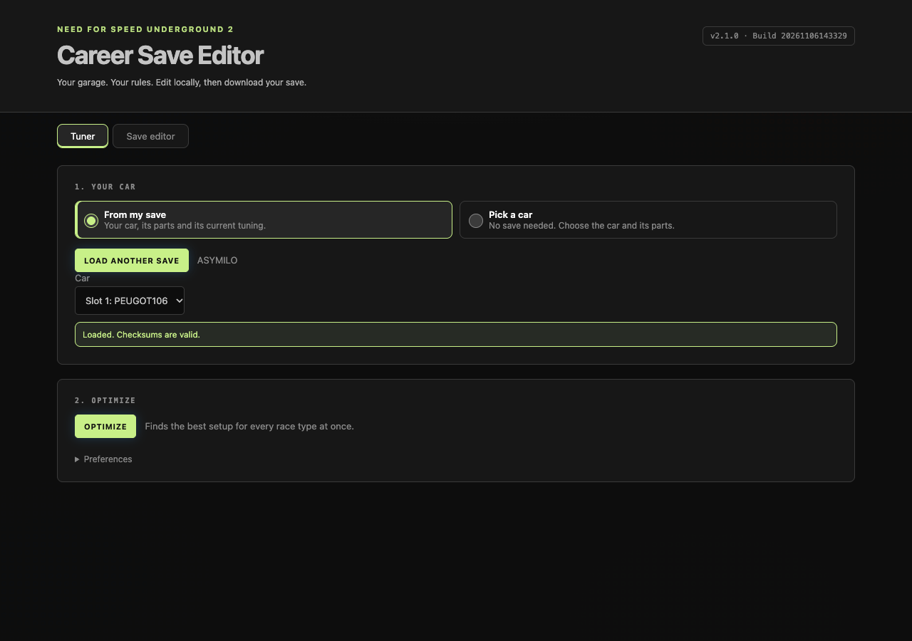 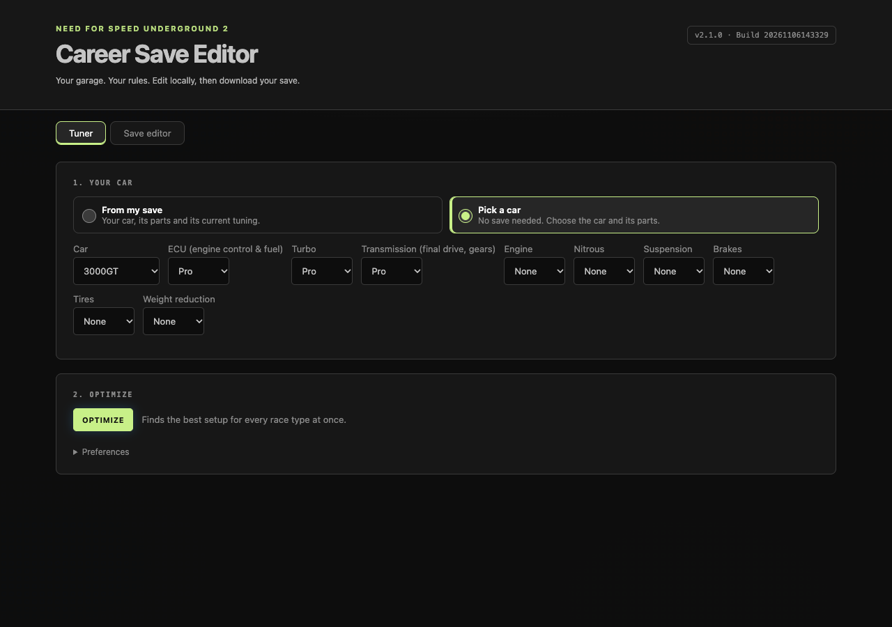 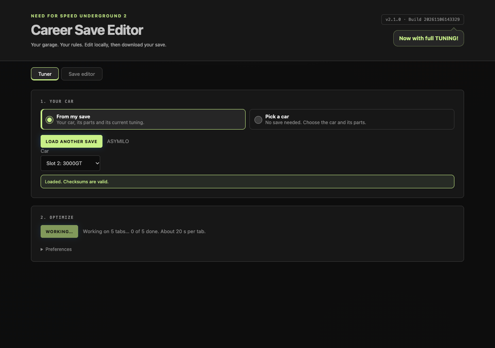
 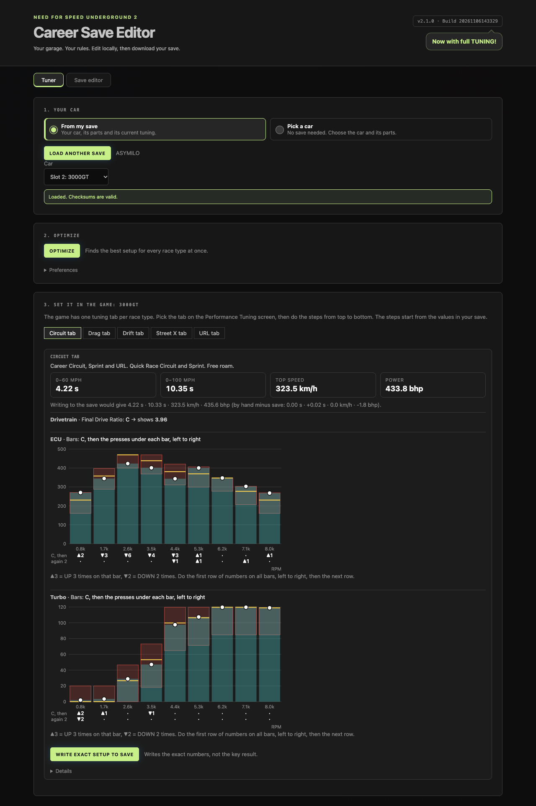 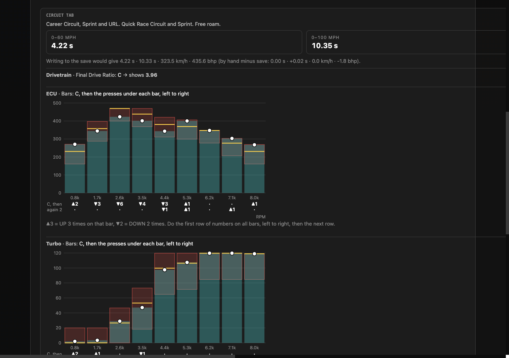
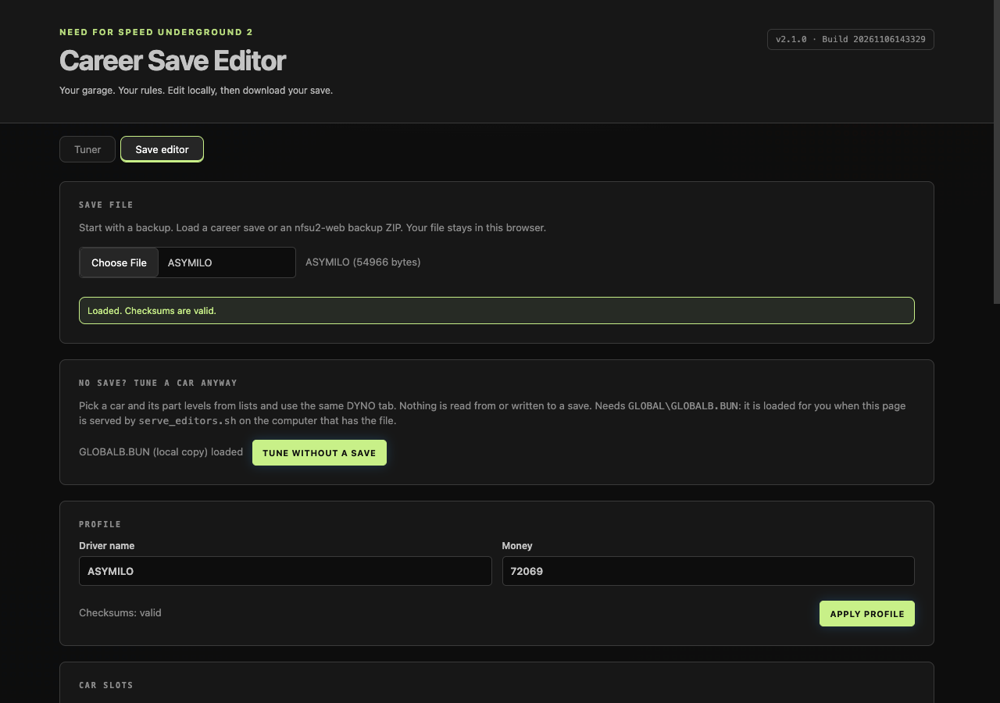 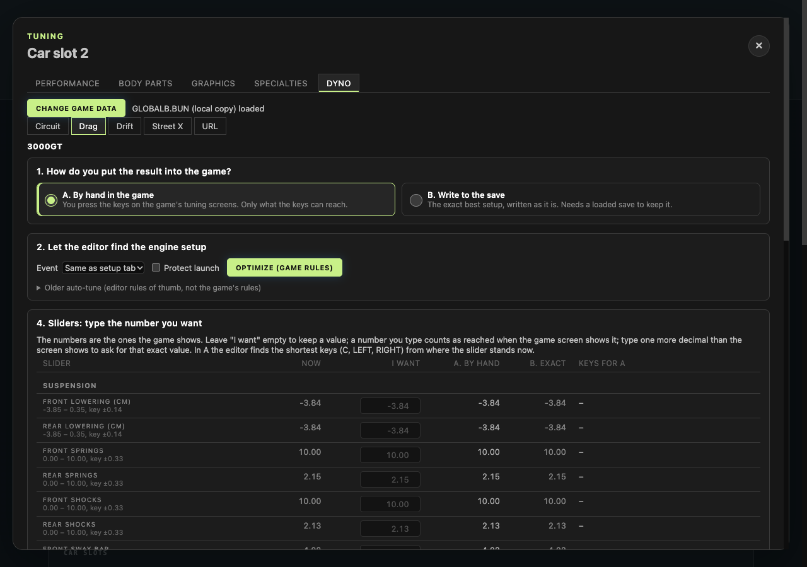 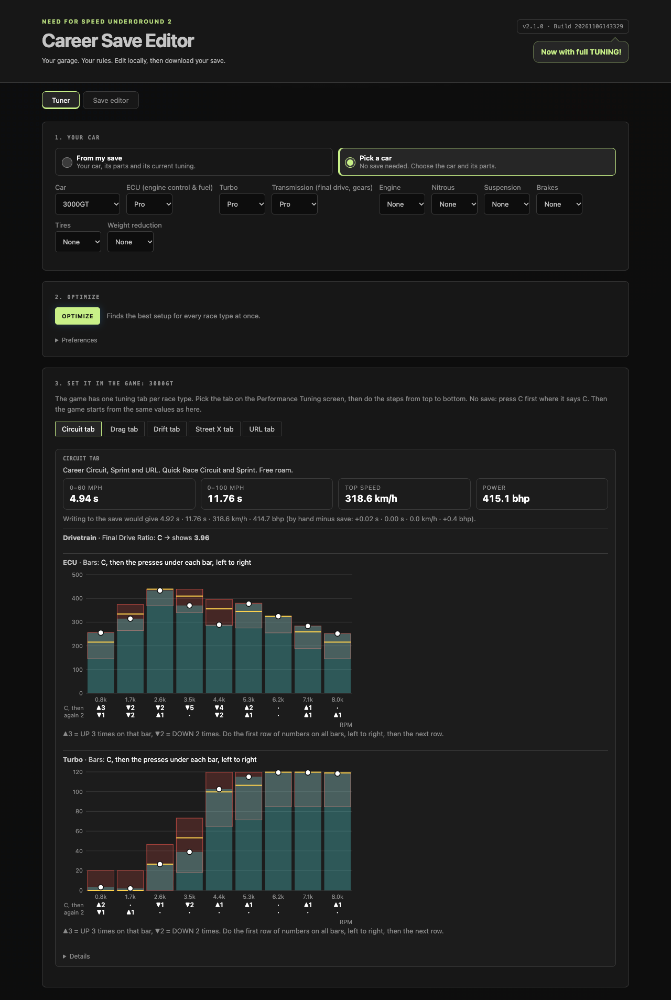
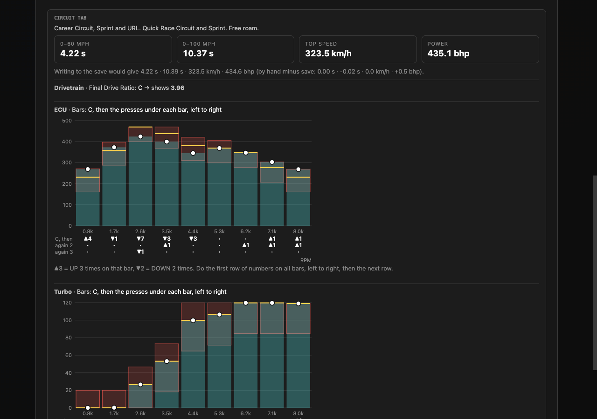

## 4. Tests

`NFSU2_GLOBALB=… npm test`: **127 tests, 106 pass, 0 fail, 21 skipped** (round 2: 123 / 102 / 0 / 21; the skips are the author's private
`treav0r` fixture). New `src/test/tuner.test.ts`:

| Test | What it checks |
|---|---|
| preferences | each choice gives the existing objective; the 90 % rule only with "strong start" |
| shared cards | tabs with equal start, keys and result go into one card, others not |
| menu order | for the 40 part sets of `dyno-exactness.json`, from the saved setup and from the no-save start: the steps in menu order (Drivetrain before ECU and Turbo), replayed with the game's key code, give the planned bytes |
| no save | every step starts with C; C on the no-save start changes nothing; every curve and drivetrain row is listed |

## 5. Design critique (from the screenshots)

| Found | Done |
|---|---|
| First version showed all five cards with two charts each: a page 6,100 px long | One card at a time behind a row of the game's tab names |
| Old screen: setup tabs, A/B choice, Event menu, Protect launch, two optimizers, 22 sliders | Two steps and one button; preferences and details folded |
| "Protect launch" did not say what it does | Gone; "Keep a strong start" says the rule and that it is our estimate |
| URL rule hidden in docs | On the Circuit and URL cards |
| Optimize takes time with no sign of life | Button says "Working…" and "n of 5 done" (`img/r3-3-busy.png`) |
| Can a user without knowledge get through? | Save or car → Optimize → card works with no other choice. Still hard: the ECU / Turbo chart with ▲/▼ rows needs the one-line legend under it; the slider screens are named but not pictured. |

## 6. Not checked / limits

- No plan of this round was keyed in the running game. The numbers equal round 2, whose round 1 plans were checked in game (`docs/dyno-check-3000gt.md`).
- Menu order: the bytes are the same in the key code (test above), not tried in the game.
- No save: "press C first on every row" assumes C works per row as measured for suspension and final drive (`native-menu-map.md` l.172-173); not tried for 6-speed gears.
- The round 2 typed slider numbers (suspension, aero, tires, brakes, nitrous) are not on the Tuner screen. They stay in Save editor -> Tuning… -> DYNO.
- Port 8771 offers `./game/GLOBALB.BUN` from `data/game/` when started with `serve_editors.sh` from nfsu2-tuner branch
  `feat/hand-input-tools-r2` (it runs `tools/serve_editor.py`, 127.0.0.1 only, file read in place, never copied). Checked
  2026-11-06: `curl -sf http://127.0.0.1:8771/game/GLOBALB.BUN` = 200, 8,008,064 bytes, same as `data/game/GLOBALB.BUN`;
  the Tuner lists 67 cars under "Pick a car" with no file prompt (`docs/img/r3-10-8771.png`).
  The `serve_editors.sh` on `dev` is still the old one (plain `http.server`, page asks for the file) until that branch is merged.
- Merging of equal tabs: unit test only. Browsers other than Brave, phone widths: not tried.

## 3c. Owner's feedback, round 3c (branch `feat/tuner-r3c` off `feat/tuner-r3`)

Feedback: key C unclear, the ▲/▼ rows unclear, no before/after, Engine / Nitrous / Suspension / Brakes "None" with no
settings, "Circuit Tab" suffix not needed, career vs Quick Race must be clear, tabs and order as in the game, car thumbnails.

| Feedback | Done | Source |
|---|---|---|
| C = reset? | Every key C reads **Reset (key C)**. One box on top: it is the game's "Reset to default"; on a slider screen it resets only the selected row, on ECU and Turbo all 9 bars. | `docs/native-menu-map.md` l.174-181 (measured) |
| ▲/▼ rows | Under each bar: **Bar 1..9**, the rpm, then per round **UP 3 / DOWN 1 / –** in words; rows named 1st, 2nd, 3rd. Three numbered lines under the chart: Reset, UP/DOWN then RIGHT to the next bar, after bar 9 LEFT ×8 back to bar 1 for the next round (changed in 3c-2: RIGHT once). | Order = `curvePlanner` in `src/model/hand-input.ts` (C, then bars 0..8 per pass); the key list that passed the in-game check does exactly this: `native/runs/dyno_check_20261106/steps_a.mjs` l.24-27 (LEFT ×8 between rounds, RIGHT after each bar) |
| Before / after | Table "Dyno: Now (save) → After the steps" (0-60, 0-100, top speed, power). Without a save the first column is "After reset". Slider steps read "Final Drive Ratio: 4.05 → 3.96. Keys: Reset (key C)". | Numbers: `gameNumbers(model.evaluate(start))` and the plan's mode A; slider numbers: `shownText` on the start and on the plan, no new numbers |
| Parts "None" | **Every card lists all 7 screens of the game's menu.** A screen without a part: **Locked**, with the parts that open it. A screen Optimize does not tune: **Leave as is**, one line at the end: Optimize tunes only Drivetrain, ECU and Turbo, the dyno measures speed, not grip or handling (checked: on the owner's 3000GT Optimize changes only byte 9 and bytes 23-40). Drift and Street X: "This race type turns nitrous off anyway". | Locked / which part: the game's tuning records in GLOBALB.BUN (`unlockParts`, `categoryScreens` in `src/model/tuner.ts`; rule `docs/setup-bytes.md` l.42); nitrous: `docs/setup-bytes.md` l.103 |
| Parts list | Every part has a line under it: what it opens in the game. Engine and Weight reduction: "Counts on the dyno. Opens no tuning screen" (no tuning record for EN or WT in the game data, test). Transmission: gears only with Extreme (6-speed). **New: Front bumper (aero) and Spoiler (aero), level 1-3**; they open Aerodynamics (front / rear downforce). The Tuner had no field for them. | Records: `docs/setup-bytes.md` l.17-40 and the game data; aero flags `AE_FRONT_BUMPER_L1..3`, `AE_SPOILER_L1..3` (`withAero` in `src/model/virtual-save.ts`) |
| Tabs | Five buttons with the game's captions in its order: **Circuit, Drag, Drift, Street X, URL Race**, no "tab" suffix. Under each name: "Circuit, Sprint, career URL" / "career and Quick Race" / "Quick Race URL only". On the card a table **Career races / Quick Race**. Tabs with the same plan keep their own button and open one card ("Same plan for the tabs Circuit + URL Race"). | Captions and order seen in game: `native/runs/dyno_check_20261106/s4/*_setting_0..4.png` (tuner repo); which race loads which tab: `docs/setup-bytes.md` l.89-103, career URL = Circuit in game l.166-174 |
| Screen order on the card | Suspension, Drivetrain, Aerodynamics, Tires & Brakes, ECU, Turbo, Nitrous. | Code: item index 0..6, `FUN_0055ab80` (`docs/native-menu-map.md` l.164-170); seen: `native/runs/tune_screens_20261106/*_master_*.png`, e.g. the Aerodynamics icon left of Tires & Brakes |
| Thumbnails | The game's own car-select logo of the picked car (white logo, 256×64) next to the car choice. | Texture `SECONDARY_LOGO_<car>` in `FRONTEND/FrontB.lzc`, found for all 32 non-traffic cars by name hash |

Thumbnails, how: the game has no 2D car picture (car select shows the 3D model); it has a name logo per car.
`tools/extract_car_logos.py` (tuner repo, branch `feat/tuner-r3c`) decodes them (JDLZ + TPK reader from
`native/nfsu2-web/tools/texpacks.py`, DXT3 → PNG) into `data/game/logos/<car>.png` (gitignored, EA's files, personal use).
`tools/serve_editor.py` serves them at `/game/logos/<car>.png` (127.0.0.1 only; only plain names, `..` gives 404). Without the
files the page hides the logo box. Wiki photos were not used: NFS wiki images are EA screenshots (copyright EA, the wiki's
CC BY-SA covers its text, not those images), and the game's own logos did the job locally. No game image is committed:
`r3c-1` in git has the logo hidden; the copy with the logo is `data/out/r3c-1-pick-car-parts-with-logo.png` of the tuner repo (not in git).

Checks (headless Brave on http://127.0.0.1:8771/, served by `serve_editors.sh`): GLOBALB.BUN loads by itself, no file prompt;
logo shown; no save, 3000GT with only ECU Pro: Suspension, Drivetrain, Aerodynamics, Tires & Brakes, Turbo, Nitrous Locked, ECU Change,
Circuit and URL Race share one card (the first run where two tabs merged in a browser); owner's save slot 2: 5 cards, 26-29 s, Circuit
5.02 / 11.38 / 309.0 / 421.4 → 4.22 / 10.35 / 323.5 / 433.8 and the ECU / Turbo presses equal round 2 and `docs/dyno-check-3000gt.md`
row 0 (checked in game in round 1); Save editor still lists the slots; no page errors.

Screens: 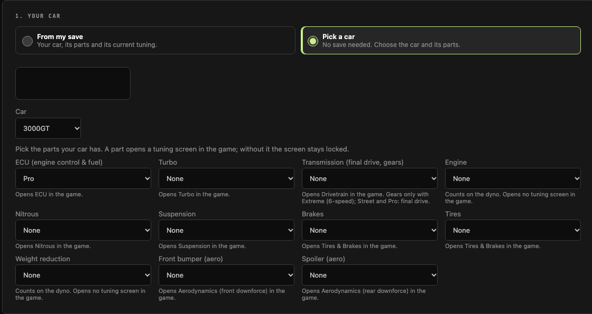 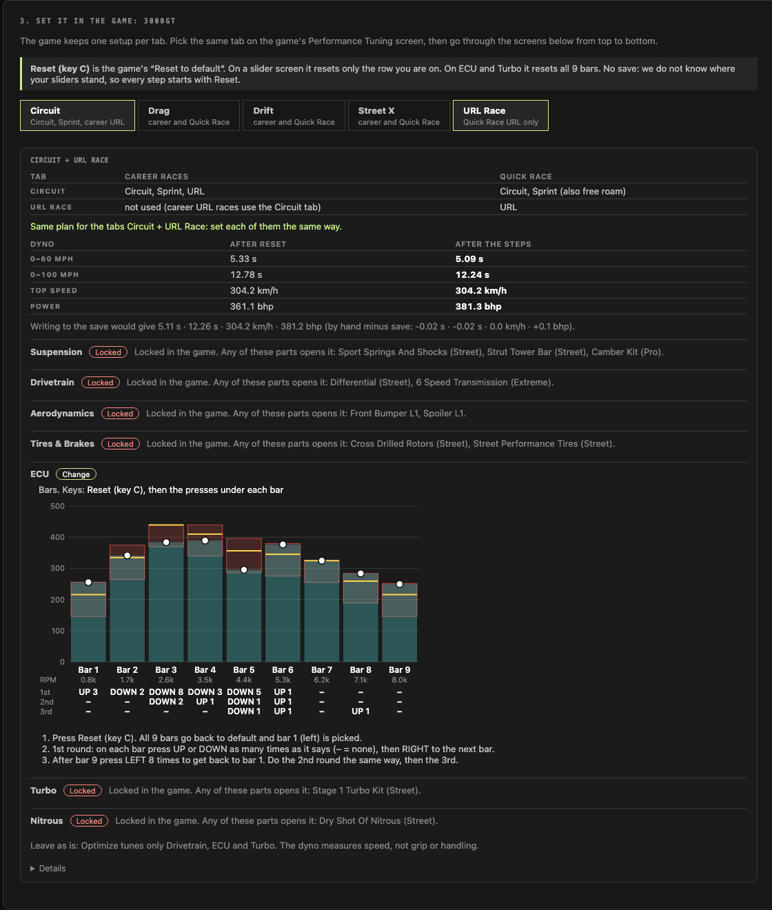
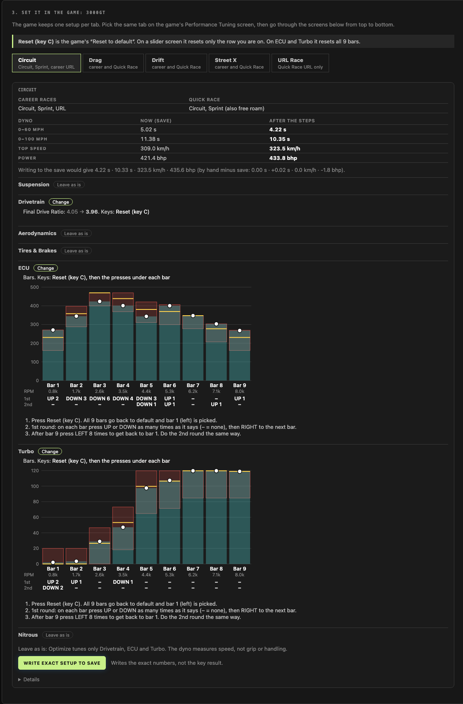 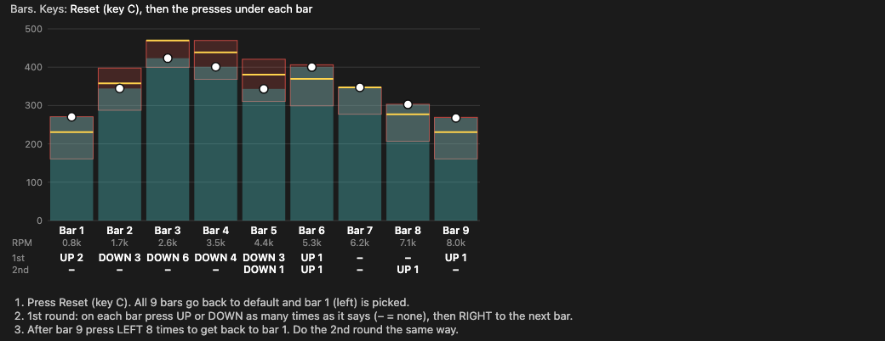 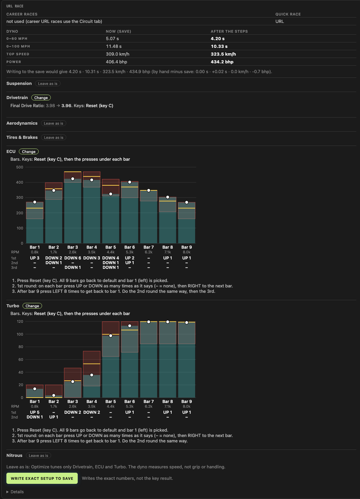
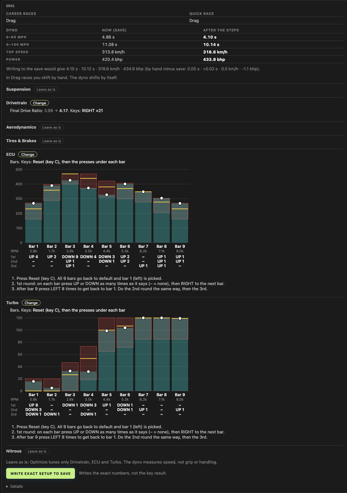

Tests: `npm test` **130, 109 pass, 0 fail, 21 skipped** (author's `save.test.ts` unchanged). New in `src/test/tuner.test.ts`: which part opens
which screen (from the game data; Engine and Weight open none), every card lists the 7 screens in menu order with locked ones,
aero levels set one flag each.

Design critique after the first 3c screenshots, fixed: the "not tuned" sentence stood four times on a card (now one line at the end);
tab sub-lines "Drag / Drag" said nothing (now "career and Quick Race"); a merged card put URL Race first in the tab row (now five
buttons in game order); "Round 2" ran into bar 1's presses (now 1st / 2nd / 3rd); the logo sat under the part list (now next to the car
choice); slider steps read keys first, values last (now "4.05 → 3.96. Keys: …"). Still heavy: ECU and Turbo charts each take a screen
height; the red / yellow marks of the chart have no legend (author's chart).

Not checked (3c, first pass; see 3c-2 for what was checked later): nothing of 3c was tried in the running game. Not seen in game: how the game shows a locked screen (hidden or greyed),
and which body parts in the shop set the aero flags (the editor reads them as flags 56-67). "Reset (key C)" resets the selected row: measured
for suspension and final drive, from code for the others; not tried on 6-speed gears. Phone widths and other browsers not tried.

## 3c-2. Bar 9 wraps to bar 1; the open points checked in the game (2026-11-06)

Owner: "on the last bar RIGHT probably jumps to the start, check it, it makes the instruction simpler". Facts and runs are in
the tuner repo (`docs/native-menu-map.md` "Graph bars wrap" and "Locked screens", `docs/dyno-check-3000gt.md` "Round 3c").

| Question | Answer | Proof |
|---|---|---|
| RIGHT on bar 9 -> bar 1? LEFT on bar 1 -> bar 9? | **Yes on ECU and on Turbo** (both ways). Nitrous has no bars: RIGHT/LEFT stop at the ends. | Code `FUN_00522eb0` (ring; `data/ghidra_decomp.c` l.206895-206925), Nitrous `FUN_00523210` l.207087; game: `native/runs/wrap_20261106/bytes.txt` (T1, T2, T4, `nos_r6`, `nos_l11`) |
| Does Reset (C) pick bar 1? | **No.** C keeps the picked bar; bar 1 is picked when the screen opens. | game: `native/runs/locked_20261106/run_L1` T5 (RIGHT ×3, C, UP moves bar 4) |
| The 3c plan typed in the game, 5 tabs of the 3000GT | Game = mode A in all 5: Circuit 4.22 / 10.35 / 323.5, Drag 4.10 / 10.14 / 318.6, Drift 4.22 / 10.22 / 318.6, Street X 4.10 / 10.12 / 309.0, URL Race 4.20 / 10.33 / 323.5. All 41 bytes checked after every key. | `native/runs/tuner3c_20261106/` (`results_A_all.png`, `records.json`, `s*/log.txt`) |
| How the game shows a locked screen | The icon stays in the list with a **padlock**; Enter does nothing. | `native/runs/locked_20261106/L1_master_all.png`, `L2_master_all.png`; fng stays `UI_PerformanceTuning_Master.fng` |
| Which body parts open Aerodynamics | A **non-stock front bumper** (front downforce) and **spoiler** (rear). Stock front bumper + stock spoiler lock it even with the save's flags set; rear bumper and side skirts do not open it. Clearing the save's aero flags does nothing: the game rebuilds them from the body parts. | game: L1 / L2 runs above; code: `FUN_006399D0` (`technical.md` "Visual-derived group-9 flags"), records `docs/setup-bytes.md` l.35-36 |
| Reset on 6-speed gears | C resets only that gear; a neighbour it pushed before stays where it is. | game, every-part copy: `native/runs/gear_lvl3_20261106/log.txt` f=4168 / f=4210 (3rd gear 78 -> 100, 4th stays 98); `docs/game-input-rules.md` |
| Does C work on Nitrous | Yes: duration and intensity back to 100. | `native/runs/wrap_20261106/bytes.txt` `nos_C1`; `tune_screens_20261106/bytes.txt` l.80 |

Changes:
- `src/model/tuner.ts` `curveKeys`: the keys of a graph = C, then bar 1..9 per round, RIGHT after each bar, RIGHT on bar 9 back
  to bar 1, stop after the last bar with presses. The card's "key presses in all" now counts every key (C, UP/DOWN, RIGHT).
  Bar moves per graph on the 3000GT: 9-25 (was 24-40 with LEFT ×8). Going LEFT to a nearer bar would save at most 3 more; not
  used, so the rule stays "always RIGHT". Test in `src/test/tuner.test.ts`.
- How-to under the chart: "Open the screen. Bar 1 (left) is picked. Press Reset (key C) ..." / "... then RIGHT to the next bar" /
  "On bar 9, RIGHT takes you back to bar 1. Do the 2nd round the same way." / "Stop after the last bar with presses."
  (the old line said C picks bar 1; the game says it does not).
- Locked screens: "Locked in the game: its icon has a padlock and Enter does nothing." Aero parts read "a body-shop front bumper
  (not stock)" / "a body-shop spoiler (not stock)"; the part list's aero hint says rear bumper and side skirts open nothing.

Screen: 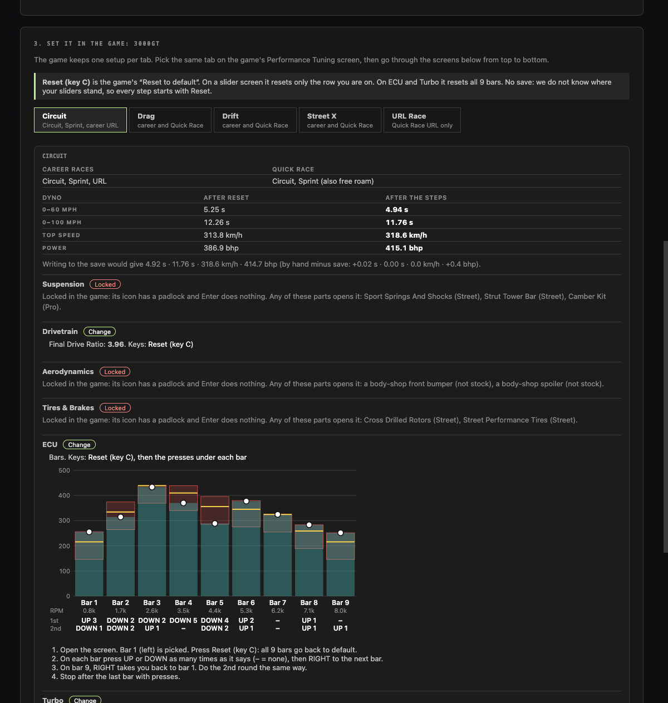 (headless Brave, http://127.0.0.1:8771/, no save, 3000GT with ECU /
Turbo / Transmission Pro; no page errors).

Tests: `npm test` **131, 110 pass, 0 fail, 21 skipped**; `src/test/save.test.ts` unchanged.

Not checked (3c-2): a stock front bumper with a body-shop spoiler (code says: only rear downforce); the Tuner's no-save mode
typed in the game; LEFT to a nearer bar (not used); imperial units; phone widths and other browsers.

## 3d. Steps one by one, "Your car now", preferences after Optimize, read-only save (2026-11-06)

Owner's points and what changed (all in `index.html` Tuner `<main>`, `src/controller/tuner-controller.ts`):

| Point | Now |
|---|---|
| Game file first, nothing else before it | Step 1 "Game data". Without it only the file button shows (`r3d-0`). With the local copy one line: "Game data: loaded" (`r3d-1`). Steps 2-5 have `ng-if="tuning.dyno.gameName"`. |
| Why 3000GT after the file? | It was hard-coded (`tuner-controller.ts:62` on 3c, `c.name === '3000GT'`). Gone: list mode starts at "Pick a car…"; a save with one car takes it, with more the user picks (`r3d-2a`: ASYMILO has PEUGOT106 + 3000GT). |
| Current info before Optimize | Step 3 "Your car now": parts per category, dyno per tab (save) or "Factory setting" (no save), folded "Slider values now" per tab (`r3d-2`, `r3d-6`). |
| Preferences = sliders, after Optimize | Folded "Preferences: tweak after you tried it" below the cards: engine goal (4 choices, re-runs Optimize) and up to 5 driving sliders for the tab on show (`r3d-4`). A slider re-plans the card's steps at once (`r3d-4a`). |
| Where "modify save" goes | No question at load: the save is only read. At the end, only with a save: "Download changed save" = a copy with the exact setup (mode B) of all 5 tabs, sliders included (`r3d-5`). Without a save one line: writing a save needs a save (`r3d-8`). The per-card "Write to save" is gone. |
| Each screen: what to buy, does Optimize tune it | Every screen line says it: locked "Buy X to open it. Then Optimize tunes it." / "Optimize does not tune it."; open "Optimize tunes it. Already right" or "Optimize does not tune it. Use its slider under Preferences, or set it yourself." Part list hints say which screen a part opens and whether Optimize tunes it. |
| Locked ECU / Turbo / Drivetrain: what-if | One line with the first part that opens it, both at the factory setting (two dyno runs, no Optimize): e.g. 3000GT with Turbo + Transmission Pro, no ECU: "With Fuel Pressure Regulator (Street), before any tuning: 0–60 5.55 s (now 5.61 s)" (`r3d-7`, `lockedWhatIf` in `src/model/tuner.ts`). A what-if with Optimize would cost 20-50 s per tab, so it is not done. |

### Preference sliders (`src/model/feel.ts`)
The game has no handling score and the dyno does not use these rows: with every slider at -100 and +100 the Circuit dyno of the
3000GT (all Extreme) stays 3.53 / 9.03 / 347.6 km/h / 506.4 bhp (script below). So the sliders are the player's choice: middle =
as now, each end = the end of the row's box. The UI says "the dyno does not measure it, so there is no best value".
Which rows and which way is checked by `src/test/feel.test.ts` (right = row value up, nitrous right = duration down).
The driving words are textbook car handling, **not checked in the game**.

| Label (left / right) | Rows it moves | What the game's code does with them |
|---|---|---|
| Ride (Soft, soaks bumps / Firm, quick to react) | Front + Rear Springs, Front + Rear Shocks (bytes 0, 4, 1, 5) | `FUN_005a3700`: force = spring·0.9·compression + 0.9·shock·speed (tuner repo `docs/setup-bytes.md` l.115-117) |
| Grip at high speed (Less / More) | Front + Rear Downforce (21, 22) | `FUN_0059e620`: downforce grows with speed (l.125-126); Street/Pro body parts can only lower it (l.53) |
| Braking (Stable, straight / Turns in more) | Brake Bias (18), right = more rear | `FUN_005a4d80`: front = 2·pedal·(1−B), rear = 2·pedal·B (l.120-121) |
| Rear end (Slides more (drift) / Grips) | Rear Grip (20) | `FUN_005a8280`: friction = grip × load (l.122-125); can only go down (l.53) |
| Nitrous boost (Long, gentle / Short, strong) | Nitrous (16, 17 coupled) | `FUN_005b3100`: one slider, longer = weaker (l.58); `FUN_00594300` adds torque × intensity (l.127). Hidden on Drift and Street X (the race turns nitrous off, l.103) |

Left out on purpose: sway bars (their force code was not found, l.118), Steering Ratio (use unknown, section C), lowering
(moves the wheels only millimetres, CG unchanged). The keys for these rows use the same key code as final drive and gears
(`tune-keys.ts` `pressRowState`; step size measured in game, tuner repo `docs/native-menu-map.md` l.175-179).

### Part level L1 vs L3 (same part, wider range)
Model run (`dist/` of this branch, 3000GT, Circuit tab, from the factory setting; ECU, Turbo and Transmission at the level, the
rest Extreme; mode A = by hand):

| Level | Factory 0-60 / 0-100 / top / power | After Optimize (A) | Gain 0-60 |
|---|---|---|---|
| 1 Street | 5.02 s / 11.88 s / 309.0 / 395.9 bhp | 4.76 s / 11.44 s / 313.8 / 412.0 bhp | −0.26 s |
| 2 Pro | 4.78 s / 11.42 s / 318.6 / 419.7 bhp | 4.42 s / 10.75 s / 323.5 / 445.8 bhp | −0.36 s |
| 3 Extreme | 4.34 s / 10.58 s / 333.1 / 472.0 bhp | 3.55 s / 9.03 s / 347.6 / 507.6 bhp | −0.79 s |

A higher level gives more power by itself and a wider box for the bars (range expansion, `docs/setup-bytes.md` l.46-55), so
Optimize gains more; Extreme also opens the 6 gears. A locked screen is skipped: Optimize only searches rows that have a
tuning record (`legal-opt.ts` `partsInfo` l.62-74).

### Checks
- `npm test`: **134, 113 pass, 0 fail, 21 skipped**; `src/test/save.test.ts` unchanged. New: `src/test/feel.test.ts` (3).
- Headless Brave on http://127.0.0.1:8771/ (server `tools/serve_editor.py` from nfsu2-tuner `feat/tuner-r3c`;
  `/game/GLOBALB.BUN` = 200, same bytes as `data/game/`), copy of the owner's ASYMILO profile: no page errors.
  Save results = 3c in the game (Circuit 4.22 / 10.35 / 323.5 ...). Downloaded copy: 98 bytes differ, all in slot 2's five
  setups (0x63b6-0x6482) and the checksums (0x14-0x1b); checksums valid. The Save editor's own download afterwards = the loaded
  file byte for byte (the Tuner did not change it). The original save on disk is unchanged (sha1 6bedc6ad…).
- Screens: `docs/img/r3d-0` … `r3d-8` (logo hidden in the shots).

### Design critique (from the shots), fixed
- Step 1 button sat on the text (`r3d-0` first run): now on its own row.
- "Slider values now" had right-aligned names: screen and row are left-aligned now.
- Engine goal and handling ran together: space above "How the car feels".
- Still open: the parts line in "Your car now" is long on one line; the card is long for a car with all parts (7 screens).

### Not checked (3d)
- None of the sliders' feel in the game (only that the bytes move the way the code says and the keys reach them in the model).
- The new Download on an nfsu2-web backup ZIP (only a raw profile was tried).
- Phone widths, other browsers.

## 3e. Author's main merged, review and user-test fixes (2026-11-06, branch `feat/tuner-r3e`)

Commits: f23d91c (merge of the author's `origin/main`, 7 commits), then the fixes below on the same branch.

| Point | Now | Evidence |
|---|---|---|
| A1 fork behind the author | Author's main merged (career access, `testfile/treav0r`, dyno table 1ec6e03). Conflicts in `index.html`, `editor-controller.ts`, `editor-scope.ts` resolved. | `npm test` below; RX8 0-100: the emulated SPEED2.EXE gives 8.04270 = the author's new table; the old 8.0213 predates PR #4 (tuner repo `tools/emu/emu_cases.py`). |
| A2 race weights | Shown on each card: "Best here means: … That is our choice; the game has no score for a setup." (`GOAL_WORDS`, `src/model/tuner.ts`) | Weights are the optimizer's own (`legal-opt.ts` l.11-17); no game code scores a setup. |
| A3 Rear end right did nothing | A slider side opens only when every row has room that way. Rear grip: left only, with "Only to the left: the game lets you only lower it." | `feel.ts` `sides`; test `feel sliders open only the sides…`; grip can only be lowered: tuner repo `docs/setup-bytes.md` l.53. |
| A4 Grip at high speed moved one axle | Street/Pro: front downforce sits at the top of the shared box, rear does not, so "More" is closed (no one-axle move). Extreme: both ways, both axles. One body part only: the label says "Front/Rear grip at high speed" and that it shifts the balance. | Same test (L1/L2: [-100,0], L3: [-100,100]); box anchor = max of the pair, `setup-bytes.md` l.49-53. |
| A5 404 on GLOBALB.BUN | Without the file the page says where it is (NFSU2 folder → GLOBAL → GLOBALB.BUN) (`tuning.dyno.localMissing`). Server: see "Run for acceptance". | shot `a0-no-game-file` |
| A6 ZIP opened "ASYMILO DVD 1" | A ZIP opens the first profile whose file is 54,966 bytes (career); DVD/magazine files are 1,048,612 bytes. A profile with no car: "This profile has no cars. Pick another profile above." | `firstCareerProfile` in `editor-controller.ts`; shots `b1-zip-loaded`, `b4-dvd-profile`. |
| A7 / A8 in the game | Mode B written to a save copy, loaded in the native game: 3000GT setups 0-4 and Peugeot 106 (ECU Street, Turbo Extreme) setups 0-1 equal the editor (0-60, 0-100, top km/h, bhp; diff 0). Mode A keyed on the Peugeot setups 0-1 (134 / 87 keys, 41 setup bytes compared after every key): diff 0. Not run: gear rows (6-speed) in mode A, Peugeot setups 2-4. | tuner repo `docs/game-check-r3e.md` (commit 583b915) |
| Details vs Reset (C) | The card's list shows only the by-hand keys; the optimizer's sheet (it says "do not reset the Drivetrain") is no longer on the Tuner. | `tuner-controller.ts` `sheet: r.handSheet` |
| 90 % at "Strong pull" | Text: "The 90 % is our own pick, not a number from the game." | |
| "by hand minus save" | Table columns "Set by hand / Downloaded save / Gap" with one line on how to read the gap. | |
| Header | "Tuner and Save Editor"; the author's "Now with full TUNING!" shows with his Save editor only (his test checks the text is in the page). | `save.test.ts` l.53 unchanged |
| Units | As the game's Dyno Results: "0-60", "0-100" (no unit), top speed km/h, power kW (`powerKw` in `gameNumbers`). | tuner repo `native/runs/dyno_check_20261106/results_A_all.png`; Circuit by hand on the owner's 3000GT = 323.5 kW, game 323.5 kW (`docs/dyno-check-3000gt.md`). |
| B2 no mode picked | No save: "Pick a car" is picked; a save picks "From my save". | |
| B3 slow, no progress | Progress bar "n of 5 race types done · s". Results are kept per car, start, race type and goal: going back to a goal is instant (0.3 s). A full run stays 40-57 s (5 workers); not made faster. | `nosave.log`, `withsave.log` |
| B4 None → red error | Neutral hint: pick the parts, at least ECU, Turbo or Transmission. | |
| B5 car codes | Names as the game shows them ("Peugeot 206", "Nissan 240SX"): maker from the car record in GLOBALB.BUN + `CAR_NAME_<record>` of LANGUAGES\English.bin (`scripts/car-names.mjs` → `src/data/car-names.ts`). | The game's Customize list starts at "Peugeot 206" (tuner repo `docs/native-menu-map.md` l.40). |
| B6 A vs B hidden, wide table | A, B and gap on the card. Tables scroll inside their box; at 420 px the page is 420 px wide. | shot `c1-narrow-206` |
| B7 hard keys | Each line is a tick box: "**Row**: press C (back to default), then RIGHT 7 times. Then it shows 5.11 (now 4.09)." Graph rows "1st time / 2nd time", axis "Bar" and "Revs". | |
| B8 mph + km/h | One set, as the game (see Units). | |
| B9 preferences fold up, Suspension "Leave as is" | The box is a button with its own state; on a goal change the cards stay until the new ones are ready. Ride moved: Suspension shows "To do" with 4 lines. | `nosave.log` ("prefs still open: true", Suspension lines) |
| B10 unsure descriptions | One line "Not sure? Leave them in the middle" and per slider "when to move it" (general car handling; the code basis stays below it). | |
| Words | Optimize → "Find best setup"; Reset (key C) → "C (back to default)"; Change / Leave as is / Locked → "To do" / "Nothing to do" / "Needs a part"; bhp → kW; mode A/B → "Set by hand" / "Downloaded save"; GLOBALB.BUN → "the game file"; LEGAL RESULT sheet removed from the Tuner. | |

### Checks (3e)
- `NFSU2_GLOBALB=<abs>/data/game/GLOBALB.BUN npm test`: **146 tests, 146 pass, 0 fail, 0 skipped** (with `testfile/treav0r` from the author's main).
  `src/test/save.test.ts` unchanged: 70 tests, all pass with the game file.
- Browser, scripts, logs and shots in tuner repo `native/runs/r3e_ui/` (gitignored) (headless Brave, files answered by Playwright routing from `dist/` and the tuner repo's `data/game/`):
  tuner repo `native/runs/r3e_ui/nosave.cjs` (no save: 3000GT, Pro ECU/Turbo, Extreme transmission, Street suspension/brakes),
  `withsave.cjs` (nfsu2.xyz-style ZIP built from a copy of `data/save/`: opens "ASYMILO (10 slots)", cars "Peugeot 106",
  "Mitsubishi 3000GT"; download changes only the ASYMILO profile (93 bytes: setups of slot 2 and checksums) and its
  GARAGE.DAT pairing bytes 0x8-0xf), `narrow.cjs` (420 px). No page errors. The owner's profile is unchanged (sha1 6bedc6ad…).

### Not checked (3e)
- Feel of the sliders in the game (as 3d).
- Other browsers, phones (only 420 px width in Brave).

## 7. Undo

Round 3e only: `git checkout feat/tuner-r3c && npm run build` in `port-editor` (branch `feat/tuner-r3e` stays for later).
Round 3d only: `git checkout 4582180 && npm run build`. Round 3c only: `git checkout feat/tuner-r3 && npm run build` in `port-editor`. All of round 3: `git checkout feat/hand-input && npm run build` in `port-editor` (the author's screen and round 2 come back as before), or delete the
branch: `git branch -D feat/tuner-r3` and `git push fork --delete feat/tuner-r3`.
